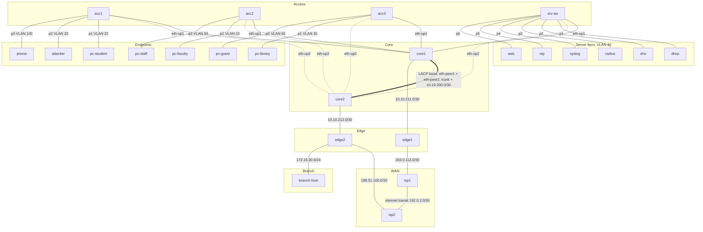

# Campus topology

Source of truth: [`campus.clab.yml`](../campus.clab.yml). This diagram is the output of
`containerlab graph -t campus.clab.yml --mermaid --offline`, regrouped by layer and
annotated with the CLAUDE.md section 3 subnets. The live view is VS Code TopoViewer.

Dotted uplinks are the ones RSTP is expected to hold in DISCARDING once M5 is built;
which uplink actually blocks is decided by the protocol at run time.
